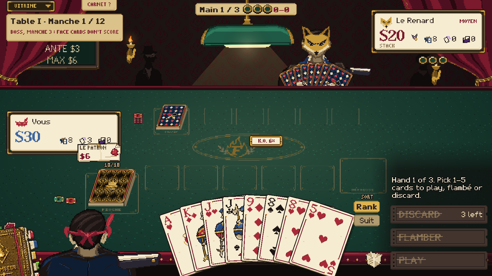
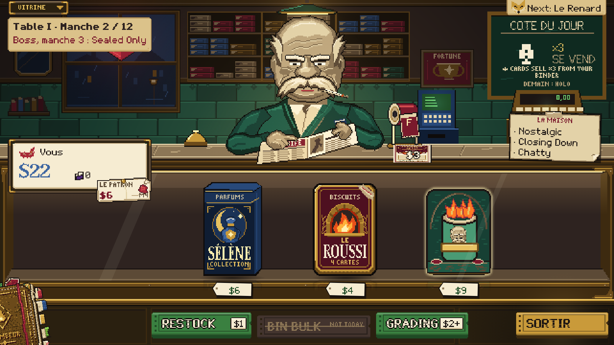
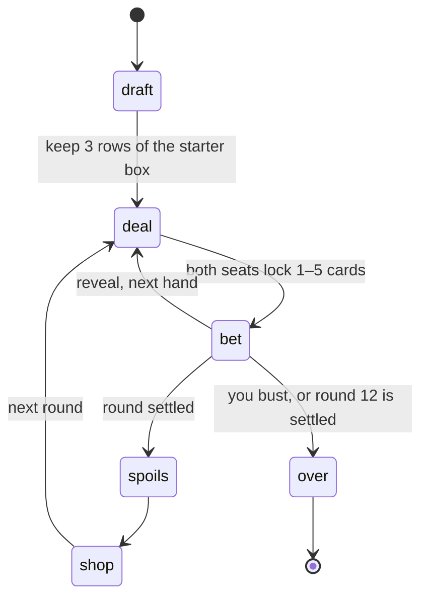

<div align="center">


**A booster-pack poker roguelike for the browser.**
Rip packs, build a tiny deck, flambé your best hands into one card, and take the rival across the table for everything they've got.


*KSU AI Club Hackathon 2026, IEEE CS Game Sprint and Nudox tracks*

</div>

<table>
  <tr>
    <td></td>
    <td></td>
  </tr>
  <tr>
    <td></td>
    <td></td>
  </tr>
</table>

## How it plays

You sit down at a Paris casino table with $20 and a debt to **Le Patron**. Your bankroll is your life and your shop money at the same time, so every dollar you spend on packs is a dollar you can't bet.

- **Rounds are best of 3 hands.** You're dealt 8 cards, discard if you want, then lock in 1–5 cards. Both seats lock at once, so nobody sees the other's hand.
- **Bet on yourself.** After locking you pick **Min** or **Max**. Max is extra money on yourself: win and the House pays it, lose and your rival takes it. The underdog bets second.
- **Higher Appraisal takes the hand.** `Appraisal = Value × Hype × 2^Grade`. Value comes from the cards that make the hand, Hype from the hand type and your display case (it triggers left to right, so order matters), and each Grade doubles the lot.
- **Flamber** merges a locked hand into one stronger card, TFT style: ★1 to ★3, with traits that stack into bonus hands. Every extra card it eats leaves a Bulk card, so the deck never shrinks.
- **The tabac** between rounds sells booster packs, collectibles for your vitrine, scratchers and a grading service that ships one card off for a round to come back graded (or damaged, if you went with La Poste).
- **4 Tables, 12 rounds, 10 rivals.** Each Table a new rival sits down with their own deck build, and every third round is a boss with a twist. Pay Le Patron's last marker after round 12 to win.

The full rules, with every number, are in [`DESIGN.md`](DESIGN.md).

## Run it

You need Node 24 and pnpm.

```bash
pnpm install
pnpm dev        # http://localhost:5174
```

Dev shortcuts: `/?quick` skips the draft to the first deal, `/?quick&shop` opens the round 2 shop, `/?quick&auto` lets your seat play itself to the end.

```bash
pnpm test                       # engine tests (node:test)
pnpm exec tsc --noEmit -p .     # typecheck
pnpm build                      # typecheck + vite build
node sim/econ.ts --runs 1000 --policy greedy --difficulty medium --starter classic
```

The server tests (`pnpm test:server`) need a Postgres database in `TEST_DATABASE_URL`. See the top of [`server/server.test.ts`](server/server.test.ts).

## How it's built

The game is split into a pure engine and the things that drive it.

- **`src/engine/`** is the whole game as plain functions with no DOM, no I/O and no `Math.random`. All randomness goes through a seeded rng with separate streams per round and per pile, so a shop restock never changes a deal, and the same seed plus the same choices always replays the same run.
- **`src/engine/match.ts`** is a phase state machine. The UI, the bots and the server all go through the same four calls: `newMatch`, `step(match, action)`, `legal(match, seat)` and `view(match, seat)`. A match is just a seed plus an action log.
- **`src/main.ts` and `src/ui/`** draw everything on one canvas: the duel, the tabac, the drawer and every panel. The art comes from Aseprite atlases and Python build scripts in [`art/`](art/), and the fonts are our own bitmap fonts drawn as text grids.
- **`server/`** runs the same engine for online play: Node 24, WebSockets, Postgres, and one actor per match that writes every action to the log before it broadcasts.



The `deal` and `bet` phases repeat for up to 3 hands per round. The reveal between them is a `showdown` event that the UI counts up. The full design is in [`docs/architecture.md`](docs/architecture.md).

### Where AI comes in

- **In the game:** the rivals are bots ([`src/engine/bot.ts`](src/engine/bot.ts)) that play through the exact same `step()` rules as you. Each of the 10 rivals in [`rivals.ts`](src/engine/rivals.ts) has a deck lane and a build that grows each Table, and the difficulty only changes how sharp they bet and how far along that build is.
- **For balance:** [`sim/econ.ts`](sim/econ.ts) plays thousands of headless runs with different bot policies and starters. Every number in `DESIGN.md` under Tuning comes from it.
- **Building it:** I directed AI coding agents (Claude Code and Codex) for code, art scripts, research and reviews, and they use [Nudox](https://nudox.org) over MCP to look up the real symbols in this repo instead of guessing. How they're told to work is in [`CLAUDE.md`](CLAUDE.md).

## Repo map

| Path | What's there |
|---|---|
| [`src/engine/`](src/engine/) | the rules: cards, hand eval, scoring, flambé, betting, deck, shop, rivals, the match state machine, and their tests |
| [`src/ui/`](src/ui/) | canvas scenes (duel, shop, title), panels, the drawer, fonts, sound |
| [`server/`](server/) | online play: accounts, lobby, match actors, migrations |
| [`sim/`](sim/) | the headless balance sim |
| [`art/`](art/) | every sprite with the scripts that build it: cards, duel, shop, title, logo, fonts, packaging |
| [`docs/`](docs/) | specs for the art, the duel, the shop, the cards, the UX frame and the v2 rework |
| [`deploy/`](deploy/) | Docker image and k3s manifests |

## Credits

- Built with [TypeScript](https://www.typescriptlang.org/), [Vite](https://vite.dev/), [Node.js](https://nodejs.org/) and pnpm. The server uses [`ws`](https://github.com/websockets/ws) and [`pg`](https://node-postgres.com/). The browser bundle has no runtime dependencies.
- Art made in [Aseprite](https://www.aseprite.org/) and with Python scripts in this repo. The fonts are drawn by hand as glyph grids in [`art/fonts/`](art/fonts/).
- Design inspired by Balatro (the scoring juice and the run structure) and TFT (merging units into stars). The court cards are the traditional Paris pattern. Research notes and sources are in [`docs/balatro-visual-research.md`](docs/balatro-visual-research.md) and [`art/logo/claude/NOTES.md`](art/logo/claude/NOTES.md).
- Code lookups for the agents by [Nudox](https://nudox.org).
