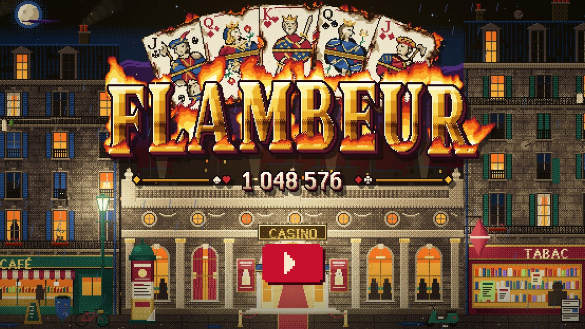
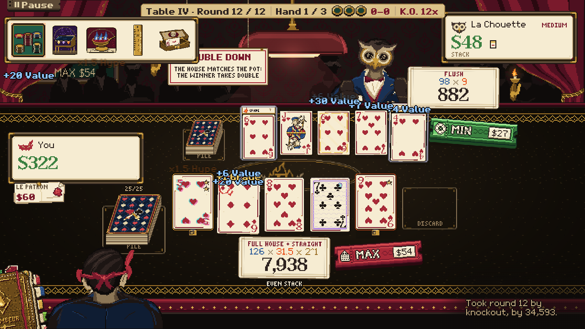
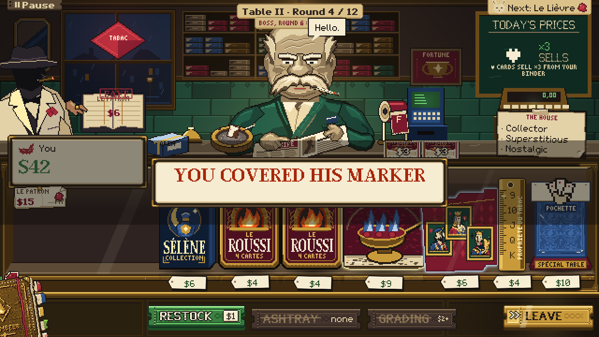
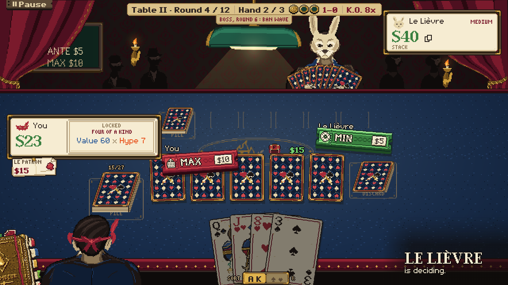
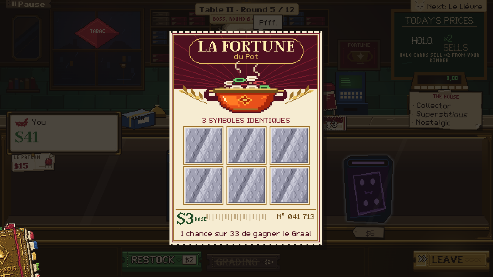
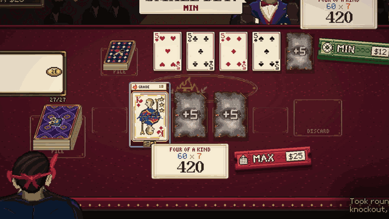
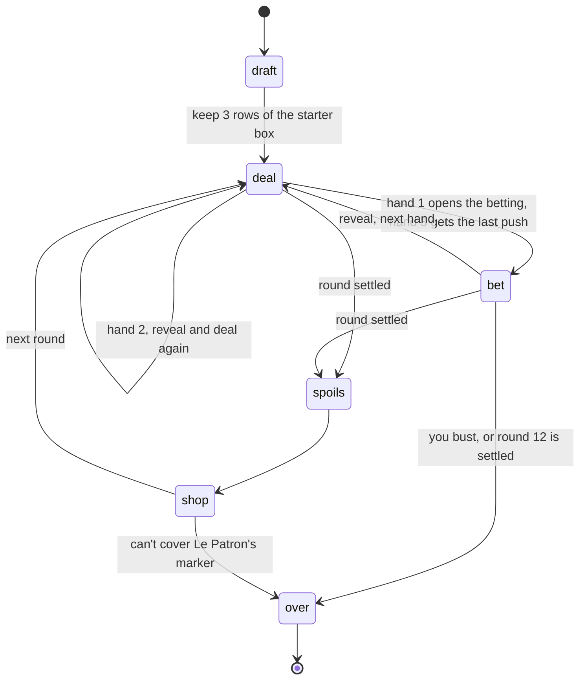

<div align="center">


**A booster-pack poker roguelike for the browser.**
Rip packs, build a tiny deck, flambé your best hands into one card, and take the rival across the table for everything they've got.

[**▶ Watch the trailer**](https://youtu.be/HZI6R9ggfoE) · [How it plays](#how-it-plays) · [Run it](#run-it) · [How it's built](#how-its-built) · [Rules](DESIGN.md)

[](https://github.com/evan-hoddinott/flambeur/actions/workflows/ci.yml)


[](LICENSE)

*KSU AI Club Hackathon 2026, IEEE CS Game Sprint and Nudox tracks*

</div>

## Trailer

<div align="center">
<a href="https://youtu.be/HZI6R9ggfoE"></a>

*2:34, cut to "Gnossienne Flambée", our own 7/4 lounge arrangement of Satie. The gameplay in it is real, filmed from the game with a seeded recorder.*
</div>

## At a glance

- **A pure, deterministic engine.** [`src/engine/`](src/engine/) is the whole game as plain functions: no DOM, no I/O, no `Math.random`. Same seed plus same choices replays the same run.
- **One state machine drives everything.** The UI, the rival bots, the balance sim and the online server all play through the same `step()`.
- **146 engine tests** with the expected numbers worked out by hand in the test names, plus a headless sim behind every number in [`DESIGN.md`](DESIGN.md).
- **Made from source.** Every sprite, the bitmap fonts, the sound atlas and the music are built by scripts in [`art/`](art/), so the art is diffable too.
- **Specs first.** Every system has a spec in [`docs/`](docs/), and [`CLAUDE.md`](CLAUDE.md) is the guide the coding agents follow.

<table>
  <tr>
    <td></td>
    <td></td>
  </tr>
  <tr>
    <td></td>
    <td></td>
  </tr>
  <tr>
    <td></td>
    <td></td>
  </tr>
</table>

## How it plays

You sit down at a Paris casino table with $20 and a debt to **Le Patron**. Your bankroll is your life and your shop money at the same time, so every dollar you spend on packs is a dollar you can't bet.

- **Rounds are best of 3 hands.** You're dealt 8 cards, discard if you want, then lock in 1–5 cards. Both seats lock at once, so nobody sees the other's hand.
- **Bet on yourself.** After the first hand locks you pick **Min** or **Max**, and after the third anyone still on Min gets one last push. Max is extra money on yourself: win and the House pays it, lose and your rival takes it. The underdog bets second.
- **Higher Appraisal takes the hand.** `Appraisal = Value × Hype × 2^Grade`. Value comes from the cards that make the hand, Hype from the hand type and your display case (it triggers left to right, so order matters), and each Grade doubles the lot.
- **Flamber** merges a locked hand into one stronger card, TFT style: ★1 to ★3, with traits that stack into bonus hands. Every extra card it eats leaves an **Ash** card, so the deck never shrinks.
- **The tabac** between rounds sells booster packs, collectibles for your vitrine, scratchers and a grading service that ships one card off for a round to come back graded (or damaged, if you went with La Poste).
- **4 Tables, 12 rounds.** Each Table a new rival from a roster of 10 sits down with their own deck build, and every third round is a boss with a twist. Pay Le Patron's last marker after round 12 to win.
- **First time?** La Fée Verte walks you through a seeded first run, one lesson the first time each thing shows up.

<div align="center">

</div>

The full rules, with every number, are in [`DESIGN.md`](DESIGN.md).

## Run it

You need Node 24 and pnpm.

```bash
pnpm install
pnpm dev        # http://localhost:5174
```

Open `/?first` for the guided first run (it's also the golden-path demo).

<details>
<summary>Tests, the sim and dev shortcuts</summary>

```bash
pnpm test                       # engine tests (node:test)
pnpm exec tsc --noEmit -p .     # typecheck
pnpm build                      # typecheck + vite build
node sim/econ.ts --runs 1000 --policy greedy --difficulty medium --starter classic
```

Dev shortcuts: `/?quick` skips the draft to the first deal, `/?quick&shop` opens the round 2 shop, `/?quick&auto` lets your seat play itself to the end, and `/flambe.html` loops the flambé on a felt.

The server tests (`pnpm test:server`) need a Postgres database in `TEST_DATABASE_URL`. See the top of [`server/server.test.ts`](server/server.test.ts).

</details>

## How it's built

The game is split into a pure engine and the things that drive it.

- **`src/engine/`** is the whole game as plain functions with no DOM, no I/O and no `Math.random`. All randomness goes through a seeded rng with separate streams per seat, round and pile, so a shop restock never changes a deal, and the same seed plus the same choices always replays the same run.
- **`src/engine/match.ts`** is a phase state machine. The UI, the bots and the server all go through the same four calls: `newMatch(config)`, `step(match, seat, action)`, `legal(match, seat)` and `view(match, seat)`. A match is just its config plus an action log, and `replay()` rebuilds it.
- **`src/main.ts` and `src/ui/`** draw everything on one canvas: the duel, the tabac, the drawer and every panel. The art comes from Aseprite atlases and Python build scripts in [`art/`](art/), and the fonts are our own bitmap fonts drawn as text grids.
- **`server/`** runs the same engine for online play: Node 24, WebSockets, Postgres, and one actor per match that writes every action to the log before it broadcasts.



Each round is up to 3 hands. The reveal after each hand is a `showdown` event that the UI counts up. The online play plan is in [`docs/architecture.md`](docs/architecture.md).

### Where AI comes in

- **In the game:** the rivals are bots ([`src/engine/bot.ts`](src/engine/bot.ts)) that play through the exact same `step()` rules as you. Each of the 10 rivals in [`rivals.ts`](src/engine/rivals.ts) has a deck lane and a build that grows each Table, and the difficulty only changes how sharp they bet and how far along that build is.
- **For balance:** [`sim/econ.ts`](sim/econ.ts) plays thousands of headless runs with different bot policies and starters. Every number in `DESIGN.md` under Tuning comes from it.
- **Building it:** I directed AI coding agents (Claude Code and Codex) for code, art scripts, research and reviews, and they use [Nudox](https://nudox.org) to look up the real symbols in this repo instead of guessing. How they're told to work is in [`CLAUDE.md`](CLAUDE.md).

## Repo map

| Path | What's there |
|---|---|
| [`src/engine/`](src/engine/) | the rules: cards, hand eval, scoring, flambé, betting, deck, shop, rivals, the match state machine, and their tests |
| [`src/ui/`](src/ui/) | canvas scenes (duel, shop, title), panels, the drawer, the tutorial, fonts, sound and music |
| [`server/`](server/) | online play: accounts, lobby, match actors, migrations |
| [`sim/`](sim/) | the headless balance sim |
| [`art/`](art/) | every sprite, font, sound and song with the scripts that build them |
| [`docs/`](docs/) | specs: art, cards, duel, shop, UX, tutorial, sound, music, the v2 rework and the multiplayer plan |
| [`deploy/`](deploy/) | k3s manifests and the deploy script (the `Dockerfile` is at the root) |
| [`presentation/`](presentation/) | the demo day deck |

## Credits

- Built with [TypeScript](https://www.typescriptlang.org/), [Vite](https://vite.dev/), [Node.js](https://nodejs.org/) and pnpm. The server uses [`ws`](https://github.com/websockets/ws) and [`pg`](https://node-postgres.com/). The browser bundle has no runtime dependencies.
- Art made in [Aseprite](https://www.aseprite.org/) and with Python scripts in this repo. The fonts are drawn by hand as glyph grids in [`art/fonts/`](art/fonts/).
- Sound effects are CC0 packs from Kenney and others on OpenGameArt, listed in [`art/sfx/CREDITS.md`](art/sfx/CREDITS.md).
- The music is an original arrangement of Erik Satie's *Gnossienne No. 1* (public domain). The melody was read from the Mutopia Project engraving; see [`art/music/SOURCE.md`](art/music/SOURCE.md).
- Design inspired by Balatro (the scoring juice and the run structure) and TFT (merging units into stars). The court cards are the traditional Paris pattern. Research notes and sources are in [`docs/balatro-visual-research.md`](docs/balatro-visual-research.md) and [`art/logo/claude/NOTES.md`](art/logo/claude/NOTES.md).
- Code lookups for the agents by [Nudox](https://nudox.org).

## License

The code is [MIT](LICENSE). Third-party sounds keep their CC0 licenses ([`art/sfx/CREDITS.md`](art/sfx/CREDITS.md)).
